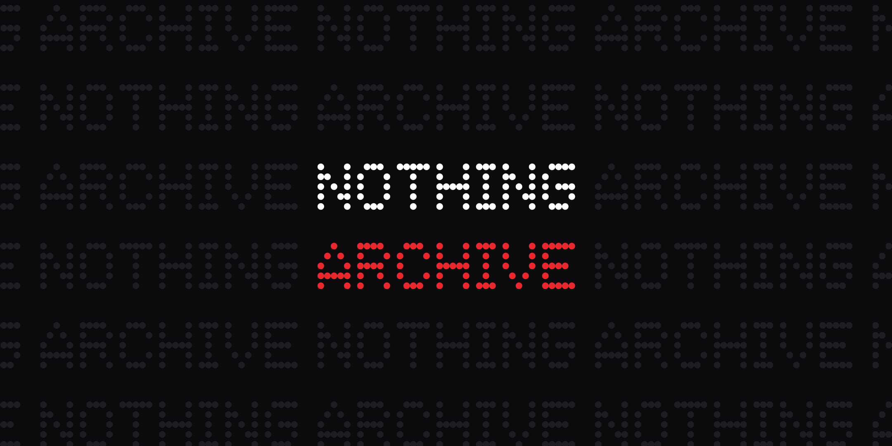

<div align="center">

<picture>
  <source media="(prefers-color-scheme: dark)" srcset="https://raw.githubusercontent.com/spike0en/nothing_archive/main/website/static/img/brand/logo-dark.gif">
  <source media="(prefers-color-scheme: light)" srcset="https://raw.githubusercontent.com/spike0en/nothing_archive/main/website/static/img/brand/logo-light.gif">
  
</picture>

# Nothing Archive

A firmware distribution and community resource hub for Nothing and CMF by Nothing devices.
It indexes official Nothing OS OTA links, changelogs, full firmware packages, stock OTA images, and step-by-step guides.
It also lists community-made apps, tools, and developer resources.

<p align="center">
  <a href="https://nothingarchive.tech/"><b>Website</b></a> &nbsp;&middot;&nbsp;
  <a href="https://nothingarchive.tech/docs/firmware"><b>Firmware</b></a> &nbsp;&middot;&nbsp;
  <a href="https://nothingarchive.tech/showcase"><b>Apps &amp; Projects</b></a> &nbsp;&middot;&nbsp;
  <a href="https://nothingarchive.tech/docs/guides"><b>Guides</b></a> &nbsp;&middot;&nbsp;
  <a href="https://t.me/s/NothingTechCommunity"><b>Community</b></a>
</p>

[](https://github.com/spike0en/nothing_archive) &nbsp; [](https://github.com/spike0en/nothing_archive/stargazers) &nbsp; [](https://github.com/spike0en/nothing_archive/releases) &nbsp; [](https://github.com/spike0en/nothing_archive/blob/main/LICENSE)

<sub>Hits show daily / total repository views tracked since 11 November 2025.</sub>

<br>

<a href="https://nothingarchive.tech/">
  <picture>
    <source media="(prefers-color-scheme: dark)" srcset="https://raw.githubusercontent.com/spike0en/nothing_archive/main/website/static/img/brand/social-banner.png">
    <source media="(prefers-color-scheme: light)" srcset="https://raw.githubusercontent.com/spike0en/nothing_archive/main/website/static/img/brand/social-banner.png">
    
  </picture>
</a>

</div>

## What the archive covers

The live site at [nothingarchive.tech](https://nothingarchive.tech/) indexes firmware, documentation, and community software built from this repository.

| Section | What you find | Source |
| :--- | :--- | :--- |
| [Firmware and OTAs](https://nothingarchive.tech/docs/firmware) | Incremental, delta, and full OTAs, stock partition images, and an interactive Partition Explorer | [`firmware.md`](website/docs/firmware.md) |
| [Device catalog](https://nothingarchive.tech/docs/devices) | Specifications, codenames, model numbers, and support windows for Nothing and CMF hardware | [`devices.md`](website/docs/devices.md) |
| [OTA changelogs](https://nothingarchive.tech/docs/changelogs) | Chronological release notes, system changes, bug fixes, and security patches for every Nothing and CMF phone | [`changelogs/`](website/docs/changelogs/) |
| [Technical guides](https://nothingarchive.tech/docs/guides) | Instructions for OTA sideloading, bootloader unlocking, rooting, backups, device recovery, and troubleshooting | [`guides.md`](website/docs/guides.md) |
| [Community Apps &amp; Projects Store](https://nothingarchive.tech/showcase) | Searchable directory of community-made apps and projects for the Nothing and CMF ecosystem | [`apps.md`](website/docs/apps.md), [`projects.md`](website/docs/projects.md) |
| [Official resources](https://nothingarchive.tech/docs/official) | Official Nothing apps, wallpapers, kernel sources, 3D models, user manuals, and EU product labels | [`official.md`](website/docs/official.md) |
| [Audio and app trackers](https://nothingarchive.tech/) | Live feeds that track audio and watch firmware binaries plus official app updates | [`accessories_updates.json`](website/src/data/accessories_updates.json), [`app_updates.json`](website/src/data/app_updates.json) |
| [Photography](https://nothingarchive.tech/docs/photography) | GCam ports, sensor XML configs, and stock camera presets | [`photography.md`](website/docs/photography.md) |

**Firmware authenticity**

- **Official sources**: Firmware links point to OEM-signed packages on Google or Nothing CDNs, with `archive.org` mirrors when official links expire.
- **Unmodified extraction**: [`.github/workflows/dump.yml`](.github/workflows/dump.yml) runs [`scripts/dump.sh`](scripts/dump.sh) with AOSP `ota_extractor` to unpack raw `.img` files without repacking or modifying system data.
- **Release verification**: Every [GitHub Release](https://github.com/spike0en/nothing_archive/releases) includes the source OTA URLs, the workflow run log (valid for 90 days), and a `<TAG>-hash.sha256` checksum manifest.

## Repository layout

| Path | Role |
| :--- | :--- |
| [`website/`](website/) | Docusaurus 3 site, React components, prebuild data scripts, and Markdown docs |
| [`scripts/`](scripts/) | Automated OTA extraction pipeline (`dump.sh`), device partition manifest (`devices.json`), and local archive helpers |
| [`bin/`](bin/) | Prebuilt `ota_extractor` binaries and shared libraries for `arm64` and `x86_64` Linux |
| [`.github/workflows/`](.github/workflows/) | GitHub Actions workflows for firmware dumps (`dump.yml`), site deployment (`deploy.yml`), and monthly link checks (`link-checker.yml`) |
| [`assets/`](assets/) | Reference screenshots for OTA sideloading |

## Local development and extraction

### Run the website locally

The site works with Node.js `20` or later (`npm`) and [Bun](https://bun.sh/) (`1.3.14` with `bun.lock` in CI).
Before starting or building, the `prestart` and `prebuild` hooks run [`fetch-github-data.js`](website/scripts/fetch-github-data.js), [`parse-devices.js`](website/scripts/parse-devices.js), and [`parse-showcase.js`](website/scripts/parse-showcase.js) to build local JSON caches.

```sh
cd website
npm install
npm run start
```

To test a production bundle locally, run `npm run build` and then `npm run serve`.
If you use Bun, install with `bun install --frozen-lockfile` and run `bun run test:performance`, `bun run typecheck`, and `bun run build` before opening a pull request.

## Contributing

Send pull requests for documentation updates, new community app and project entries, or website improvements.

Read [CONTRIBUTING.md](CONTRIBUTING.md) before submitting changes.
It explains table formatting, alphabetical sorting, and platform keyword rules.

| Scope | Status | Target paths |
| :--- | :--- | :--- |
| Device catalog and guides | Open | [`devices.md`](website/docs/devices.md), [`guides.md`](website/docs/guides.md), [`official.md`](website/docs/official.md), [`photography.md`](website/docs/photography.md) |
| Community apps and projects | Open | [`apps.md`](website/docs/apps.md), [`projects.md`](website/docs/projects.md) |
| Website source and scripts | Open | [`website/src/`](website/src/), [`scripts/`](scripts/) |
| Firmware index and changelogs | Restricted (project maintainers) | [`firmware.md`](website/docs/firmware.md), [`changelogs/`](website/docs/changelogs/) |
| Featured directory overrides | Restricted (project maintainers) | [`showcase-config.json`](website/src/data/showcase-config.json) |

## Licensing and attribution

Nothing Archive uses separate licenses for code, curated documentation, extraction tools, and brand assets.

- **Documentation and firmware tables**: Licensed under [CC BY-NC 4.0](LICENSE). CC BY-NC 4.0 and EU TDM Article 4 terms prohibit commercial generative AI model training and automated scraping.
- **Website source and automation scripts**: Code under [`website/`](website/) (excluding `website/docs/` content) and [`scripts/`](scripts/) uses the [MIT License](LICENSE-MIT).
- **Extraction binaries**: `ota_extractor` and its shared libraries under [`bin/`](bin/) come from AOSP and Chromium under Apache 2.0 and BSD-3-Clause terms. See [`bin/README.md`](bin/README.md).
- **OEM firmware and product assets**: Nothing Technology Limited owns all official OTA links, system APKs, device renders, and manuals. We index them for non-commercial recovery and hardware identification under nominative fair use.
- **Project branding and fonts**: Brand graphics under `website/static/img/brand/` are proprietary to Nothing Archive. Font licensing details live in [`website/static/fonts/README.md`](website/static/fonts/README.md), and image licensing details live in [`website/static/img/README.md`](website/static/img/README.md).

> [!IMPORTANT]
> If you mirror, adapt, or republish guides or compiled tables from this repository, credit **Nothing Archive** clearly and link back to `https://github.com/spike0en/nothing_archive`.

## Acknowledgements and support

For full project credits, see [Acknowledgements](website/docs/acknowledgements.md) and the [GitHub Contributors](https://github.com/spike0en/nothing_archive/graphs/contributors) page.

If the archive helps you, star the repository to improve visibility and support ongoing maintenance.
You can also help cover domain, server, and maintenance costs through the donation modes listed on the [Nothing Archive Support Panel](https://nothingarchive.tech/#support).

Thank you for your support.

<div align="center">
  <a href="https://www.star-history.com/?repos=spike0en%2Fnothing_archive&type=date&legend=top-left">
    <picture>
      <source media="(prefers-color-scheme: dark)" srcset="https://api.star-history.com/chart?repos=spike0en/nothing_archive&type=date&theme=dark&legend=top-left&sealed_token=NcVgyxYK8-jUI033z9tzG6AFGZLdqldpomXFSofgrxrvb8PMZqfNREtTpK163Xt2AJSrHQUZtWvr3vdO4xyoCsN6wGFoANqWn3VwYKnzzwlb8eVxnhAc3MkoYCLQ2UqFclIGFG3BBambKWD_jzqGR8DjyPy3o9PNc9xSOn5wLsPx7g3hviz8DG3Ut7G6" />
      <source media="(prefers-color-scheme: light)" srcset="https://api.star-history.com/chart?repos=spike0en/nothing_archive&type=date&legend=top-left&sealed_token=NcVgyxYK8-jUI033z9tzG6AFGZLdqldpomXFSofgrxrvb8PMZqfNREtTpK163Xt2AJSrHQUZtWvr3vdO4xyoCsN6wGFoANqWn3VwYKnzzwlb8eVxnhAc3MkoYCLQ2UqFclIGFG3BBambKWD_jzqGR8DjyPy3o9PNc9xSOn5wLsPx7g3hviz8DG3Ut7G6" />
      
    </picture>
  </a>
</div>
